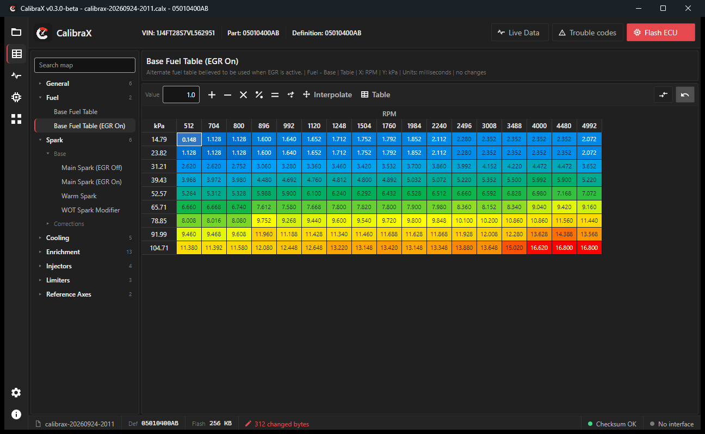

# CalibraX

CalibraX is a Windows desktop application for tuning JTEC engine control units
(ECUs) used in 1996-2005 Chrysler, Jeep, and Dodge vehicles (68HC16-based,
communicating over J2534/SCI). It lets you read and write the ECU's flash memory,
edit calibration tables and scalars with the correct addresses/scales for your
specific part number, compare edits against the original file, undo changes, and
visualize tables as curves or 3D surfaces.

Website: [calibrax.davgeek.com](https://calibrax.davgeek.com)

## Features

- **Read ECU flash** over a J2534 pass-thru interface, or open a previously saved
  project file. Choose whether the controller is a JTEC or a JTEC+ before reading.
- **Table and scalar editors** with correct units, scaling, and axis breakpoints
  per part number — no hand-picked offsets.
- **Compare & Undo** against the original flash image while editing, with a
  per-table count of what changed.
- **Curve and 3D surface views** for any table, alongside the standard grid.
- **Logger**: live engine data, log tables that fill in as you drive, and a
  viewer for recorded logs. [More](../../wiki/Logger-and-trouble-codes)
- **Trouble codes**: read stored, pending, and one-trip fault codes, named from
  your calibration when possible.
- **Apps**: extend CalibraX with additional tools that run inside the app — the
  first one available is a byte-level Hex Editor for the flash and other
  captured memory images. 🔒 *some apps require a separate license*
- **Growing vehicle coverage**: support for new part numbers is added regularly.
- **Automatic update check**: the app checks this repository on startup and
  points you to the latest release when one is available.
- **Write ECU flash / checksum repair** 🔒

Everything above except the parts marked 🔒 works with no license at all.

## Supported vehicles

JTEC (1996-1998) and JTEC+ (1999-2005) calibrations for Jeep Cherokee, Wrangler,
Grand Cherokee and Liberty, Dodge Ram, Dakota, Durango, vans and Viper.
See the [full list by year, vehicle and engine](../../wiki/Supported-vehicles).
Supported J2534 devices are listed on [Supported interfaces](../../wiki/Supported-interfaces).

## Download

Grab the latest build from the [Releases](../../releases) page. Each release is a
portable, self-contained `.exe` for Windows (win-x86) — no separate .NET runtime
install required. Unzip and run `CalibraX.exe`. If Windows SmartScreen warns about
the file, see the [FAQ](../../wiki/Licensing-and-FAQ).

## Licensing

CalibraX is free to download and try: you can open a project, browse calibrations,
and edit tables/scalars without a license. Writing a checksum-valid flash back to
a real ECU, and some optional apps, require a license. To purchase one, contact
the developer. Details in the [FAQ](../../wiki/Licensing-and-FAQ).
